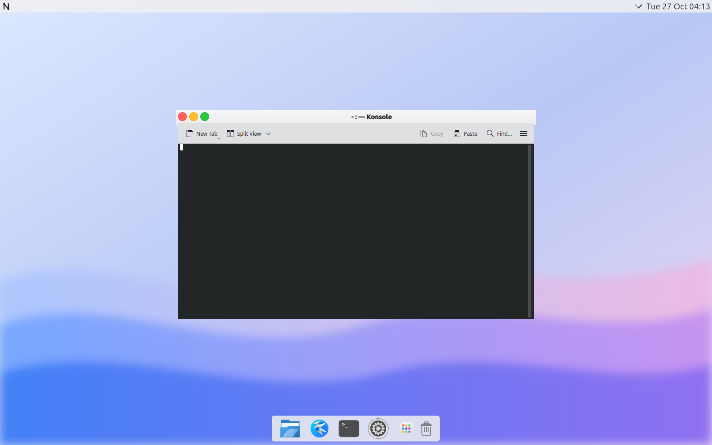
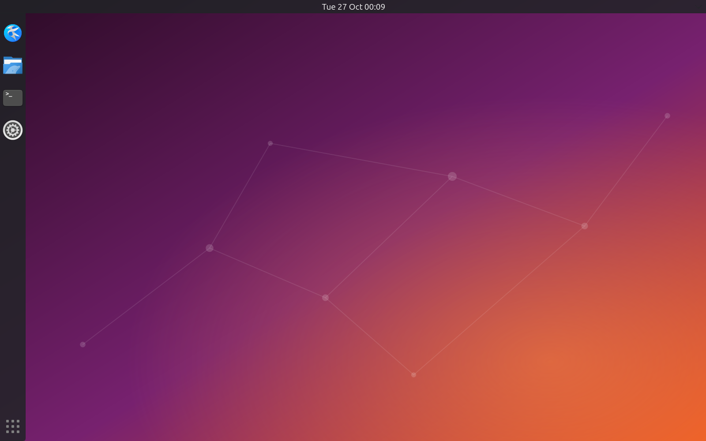

# N-OS layouts for KDE

`tools/linuxfs/desktop/nos-kde-layout` runs before Plasma starts (from `droiddeck-desktop`) and puts
an N-OS look on KDE at native speed. `~/.config/nos-kde-layout` picks the layout:

| Value | Layout |
|---|---|
| `atelier` (default) | macOS-style, after the Atelier web desktop: light menu bar on top (N-OS menu, app menus, tray, date and clock), a floating dock at the bottom (apps, Launchpad, Trash), traffic-light window buttons on the left with a centred title, blue accent, the Flow wallpaper |
| `ubuntu` | dark top bar with the clock in the centre, dock on the left, orange accent |
| `classic` | Plasma's own layout, restored from the backup taken when an N-OS layout was first applied |

- Every session it installs the look-and-feel package (`org.nos.desktop`), the `NOS-Yaru` icon theme
  (Yaru, falling back to Breeze for the KDE icons Yaru lacks), the wallpapers, the menu and Launchpad
  icons and the `N-OS-Atelier` Aurorae window decoration.
- When the chosen layout or `VERSION` changes, it backs up the user's Plasma files as `*.pre-nos`
  (first time only), removes the saved layout so Plasma builds the new one, and writes the settings.
- The traffic-light decoration needs KWin's Aurorae engine (`kwin-style-aurorae`, runtime r4 and
  newer); without it the layout keeps Breeze with the buttons on the left.

Tested in an Ubuntu 26.04 chroot: Plasma nested in a headless Sway (the app's compositor stand-in).
